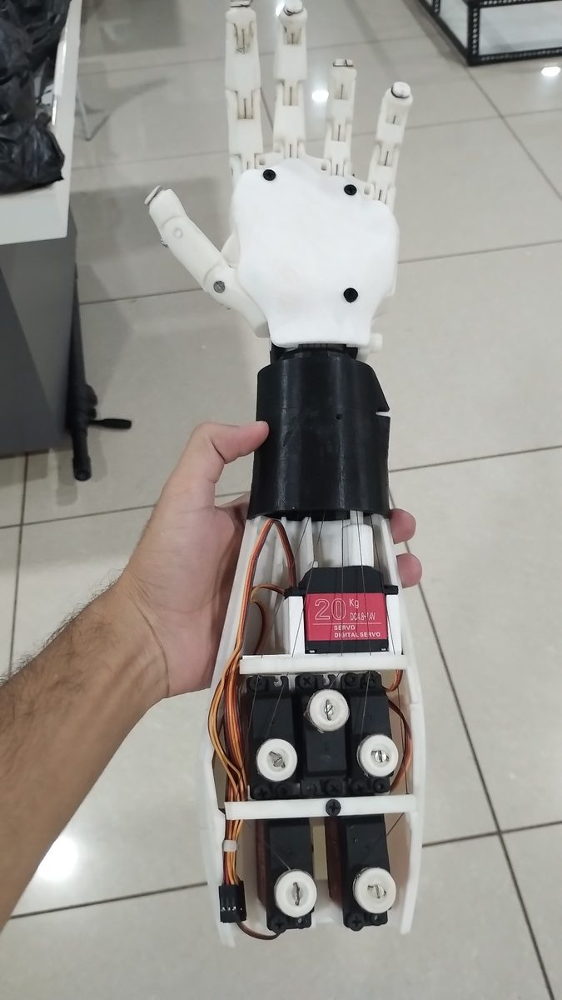
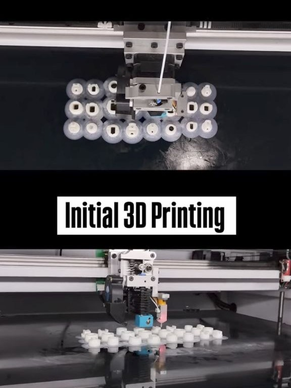
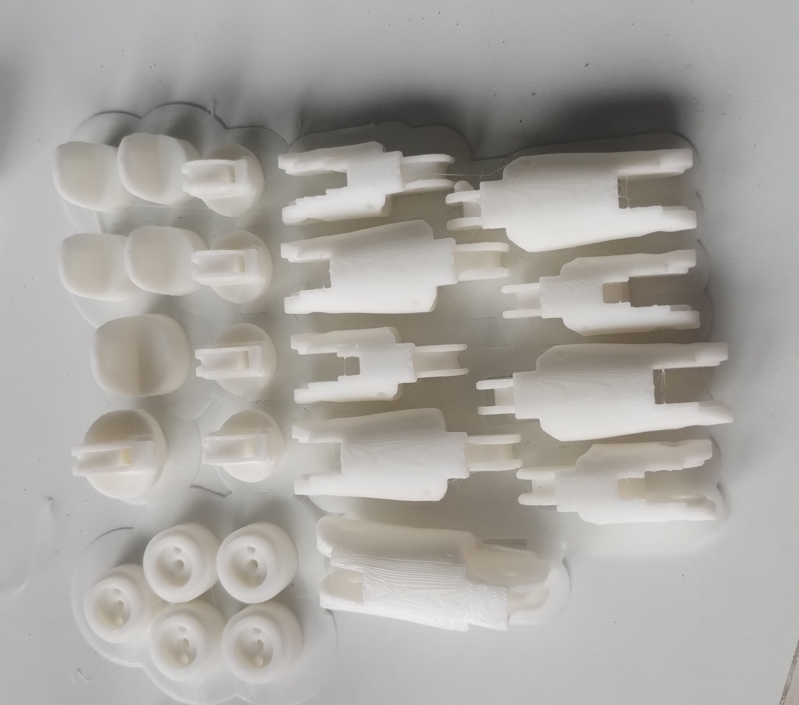
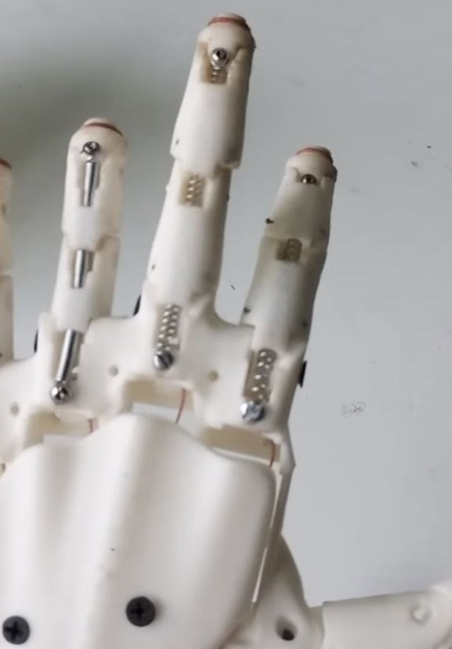
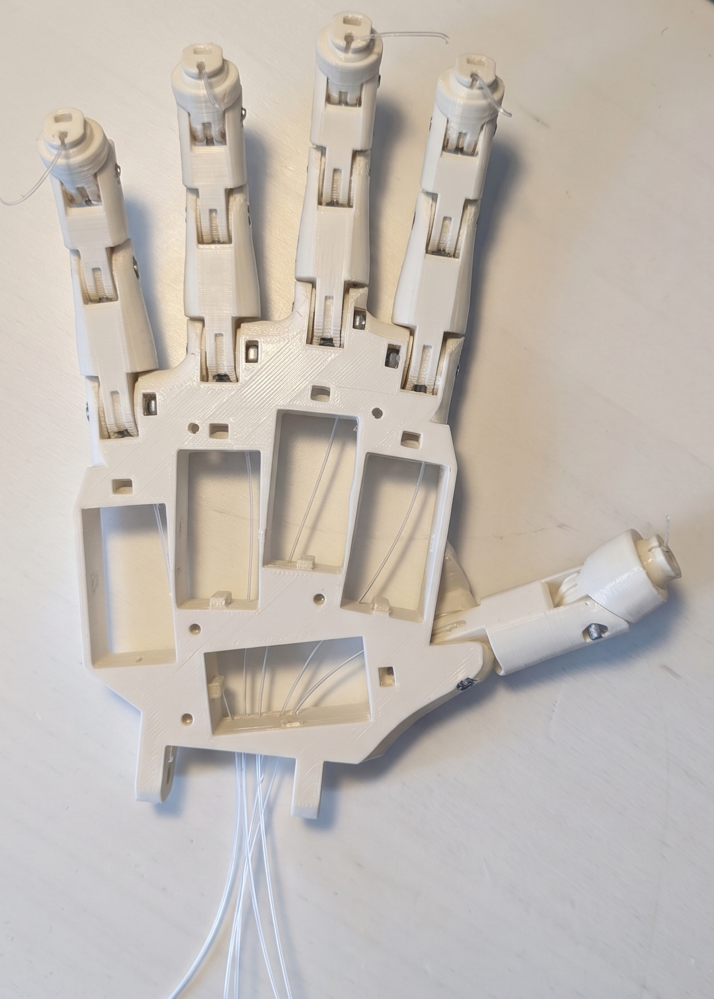
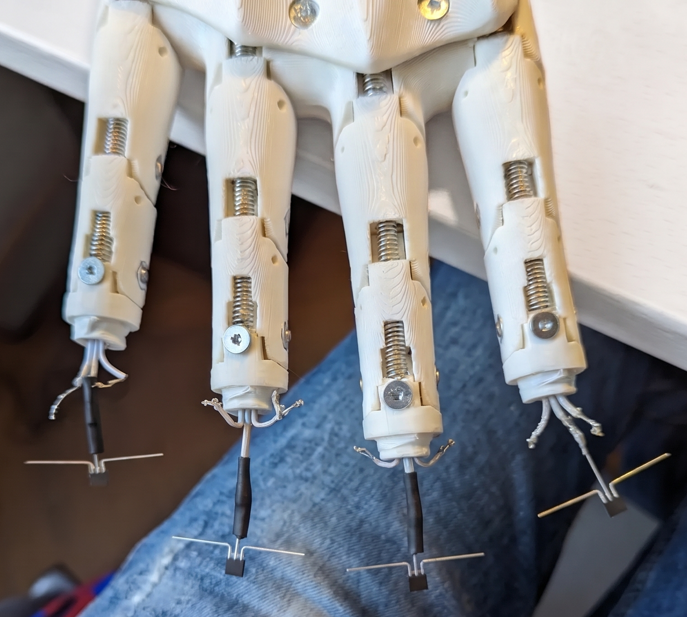
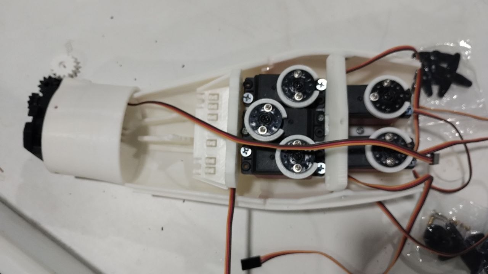

# Tendon-driven tactile hand

A 3D-printed tendon-driven hand with a hall-effect touch sensor in every
fingertip. Each finger is pulled by one 20 kg.cm digital servo through a
braided-line tendon, and the fingertip sensors let the hand stop closing as soon
as it touches something instead of stalling the servo against the object.

<!-- Replace with your own photo -->

## How it works

- Arduino Mega 2560 runs the control loop: PCA9685 over I2C for the five
  servos, five analog hall sensors on A0-A4.
- Raspberry Pi 4B talks to the Mega over USB serial for control, logging and
  experiments.
- Each fingertip is a molded silicone cap with a small magnet over an AH3503
  linear hall sensor. Pressing the tip moves the magnet closer and shifts the
  sensor output.
- Firmware takes a baseline, filters the readings, detects contact with a
  hysteresis band, and while closing it holds a finger in place once its
  reading passes a configurable limit. Opening is never blocked.

## Hardware

Parts: [hardware/bom.csv](hardware/bom.csv).
Assembly: [docs/assembly.md](docs/assembly.md).
Wiring: [docs/wiring.md](docs/wiring.md).

## Build log

### Printing
<!-- what you printed, settings, problems -->

Parts used (i2 hand, one hand)
i2_CoverFingerV3, i2_FingersMoldX5V3, i2_FingersTipX5V2, i2_FingersX5V1, i2_HandCoverV1, i2_PalmCoverV2, i2_PulleyX5V1, i2_WristGearV1, i2_WristLargeV2

Print settings i used:

- Printer: Bambu lab h2d
- Material: Pla + and ABS
- Layer height: 0.16
- Infill / walls: 55% / 4

### Assembly
<!-- joints, tendons, what went wrong -->

### Fingertip sensors
<!-- molding the silicone, magnet orientation, sensor soldering -->

- Each fingertip uses an AH3503 Hall-effect sensor and a small magnet.
- When the fingertip touches an object, the silicone cap deforms and changes the magnet-to-sensor distance.
- This changes the magnetic field detected by the Hall sensor.
- The sensor produces an analog output that is read by the controller.
- A threshold is used to detect contact and stop further finger closing.

### Assembling Servos

- Mounted five servo motors inside the palm.
- Routed braided-line tendons through each finger.
- Connected each tendon to its respective servo for finger movement.
- Installed Hall-effect sensors and magnets inside the silicone fingertip caps.
- Completed the wiring and tested individual finger movements.

## Current Limitations

- Finger position is open-loop. The servos have no feedback to the controller,
  so tendon slack or stretch is not observed.
- The tactile channel reports indentation magnitude per fingertip. It does not
  resolve contact location or shear, and it drifts with temperature and
  silicone ageing, hence the re-zero command.
- One tendon per finger with spring return fixes extension force and gives no
  independent joint control within a finger.
- Contact and grip thresholds are tuned by hand per build, in ADC counts, not
  calibrated to physical units.

## Future Work

- Calibrate the Hall signal against a load cell to report force in newtons.
- Add servo-side position or current sensing to close the loop on tendon
  tension.
- Use the five tactile channels for slip detection and in-hand adjustment
  rather than contact-only logic.
- Move to compliant or underactuated finger linkages so the mechanism adapts
  to object shape passively.

